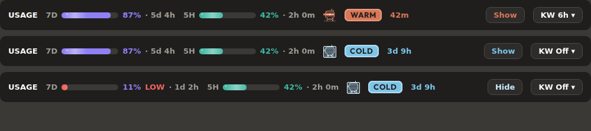
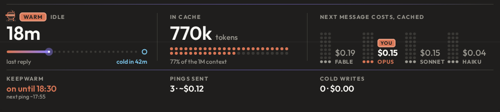

# glitchband

A band above the prompt for Claude Code. It shows how much of your 7-day and 5-hour usage is left, whether the prompt cache is WARM or COLD, what the next message costs, and it can hold the cache warm with a ping while you are away.





Warm and frozen netrunner, at 4x:  

## What you see

- Usage: one bar per window (7D violet, 5H teal) showing how much is left, with the percent and the time to reset. A window under 15% turns red and adds LOW. The terminal keeps dots.
- Cache: after the first reply, WARM for an hour after the last request, then COLD with the price of re-caching. The netrunner is lit with rising sparks while warm and frozen under ice while cold. The Show / Hide button opens a card with the idle time, the context size and the cost by model; it only opens when it fits the rows the band may take, and short of room its keepwarm strip folds to one line.
- Keepwarm: a small select in the row, `KW Off`, `90m`, your window (6h), `12h` or `Always`, each doing what the `/keepwarm` command of that name does. The open card says the state in colour (`on until 18:30` with the next ping, `always on`, `stopped: <why>`, `off`), the pings sent with their estimated cost and the cold writes paid this session.
- Narrow bands and the terminal use short forms (`KW 18:30`, `KW off`). The terminal draws text only, with no drawings and no card.

## Install

From a terminal session, with the marketplace in this repository:

```
/plugin install glitchband --marketplace null-runner/glitchband
```

Answer `y` to add the marketplace, then pick a scope. From a shell: `claude plugin install glitchband --marketplace null-runner/glitchband`.

By hand, from a clone:

```
git clone https://github.com/null-runner/glitchband
CLAUDE_CODE_PLUGIN_DIRS=$PWD/glitchband claude
```

`claude --plugin-dir ./glitchband` does the same for one run. Check the folder with `claude plugin validate glitchband` and `claude plugin test glitchband`.

## Commands

```
/keepwarm               hold the cache warm for the configured window (6h by default)
/keepwarm 90m           a window of your choice (2h30m works too)
/keepwarm always        every session stays warm until 6 hours after its last turn
/keepwarm 6h every 2m   ping period from 1m to 59m, for that window only (for trying it out)
/keepwarm status        window, next ping, last ping
/keepwarm off           stop, forget the window and turn always off
/glitchband             cache estimate, cold price, cold writes of this session
/glitchband guard warn  show the price and send
/glitchband guard refuse  hold a cold send once (default)
```

## Options

Set them in the plugin's configuration screen or under `pluginConfigs` in your settings.

- `language`: `en` (default), `auto` or `it`. `auto` follows Claude Code's `language` setting, then the system locale, then English.
- `compactBelow`: columns under which the wide row drops the word "left" and folds keepwarm into its button. Default 110, from 40 to 400.
- `cardScale`: how much larger the cache card's text reads. Default 1, from 0.5 to 3. Above 1 the wide card gets cramped on a desktop-width band.
- `keepwarmWindow`: what the button and a bare `/keepwarm` arm, as hours and minutes. Default `6h`, from 1m to 48h.
- `coldGuard`: default on. Off lets a message sent on a cold cache through without holding it back.

A value outside its range, or of the wrong type, falls back to its default.

## What the pings cost

Each ping is one request to the model on the session transcript, sent after 50 minutes of inactivity inside the armed window. It costs a cache read plus an answer of a few words. The cost is estimated with list prices kept in the code (`PRICES` in `src/keepwarm/engine.ts`) and summed on the card. Keepwarm stops by itself when a ping reads nothing or writes more than 10% of what it reads. On a subscription the dollars are a yardstick, not a bill. The mod makes no network calls of its own.

## Credits

The band and the cache card come from ribbon by Jay E (RoboNuggets), MIT. Keepwarm, the cold-send guard and the cache estimate command come from cache-tax by Karan Bansal, MIT. Their copyright notices are in `LICENSE`.

## Italiano

Una banda sopra il prompt di Claude Code: quanto resta delle finestre di uso a 7 giorni e a 5 ore, se la cache del prompt è CALDA o FREDDA, quanto costa il prossimo messaggio, e un keepwarm che tiene calda la cache con un ping mentre sei via.

Installazione, da una sessione nel terminale:

```
/plugin install glitchband --marketplace null-runner/glitchband
```

Rispondi `y` per aggiungere il marketplace e scegli lo scope. A mano: clona il repository e avvia `CLAUDE_CODE_PLUGIN_DIRS=$PWD/glitchband claude`.

Comandi: `/keepwarm` (finestra di default, 6h), `/keepwarm 90m`, `/keepwarm always`, `/keepwarm status`, `/keepwarm off`, `/glitchband` (stima della cache, costo a freddo, scritture a freddo della sessione), `/glitchband guard warn|refuse`.

Opzioni: `language` (`en` di default, `auto`, `it`; `auto` segue la lingua impostata in Claude Code, poi quella del sistema), `compactBelow` (colonne sotto cui la riga larga diventa compatta, default 110), `cardScale` (scala del testo della scheda, default 1), `keepwarmWindow` (durata armata dal pulsante e da `/keepwarm` senza argomenti, default `6h`), `coldGuard` (default attivo: se spento il messaggio a freddo passa senza essere fermato). Un valore fuori range o del tipo sbagliato torna al default.

Costo dei ping: ogni ping è una richiesta al modello sulla trascrizione, dopo 50 minuti di inattività dentro la finestra armata. Costa una lettura di cache più una risposta di poche parole, stimata con i prezzi di listino nel codice e sommata nella scheda. Si ferma da solo se la lettura è zero o se la scrittura supera il 10% della lettura. Sugli abbonamenti i dollari sono un metro, non il conto.

Crediti: banda e scheda della cache da ribbon di Jay E (RoboNuggets), keepwarm e guardia da cache-tax di Karan Bansal, entrambi MIT (vedi `LICENSE`).
